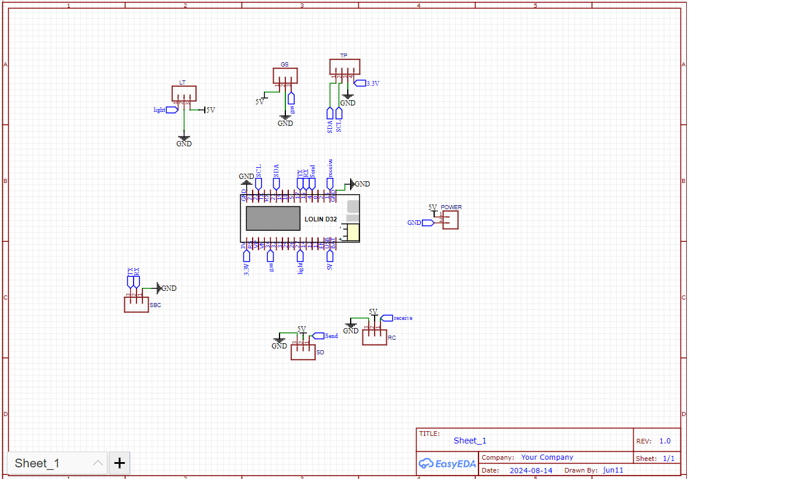
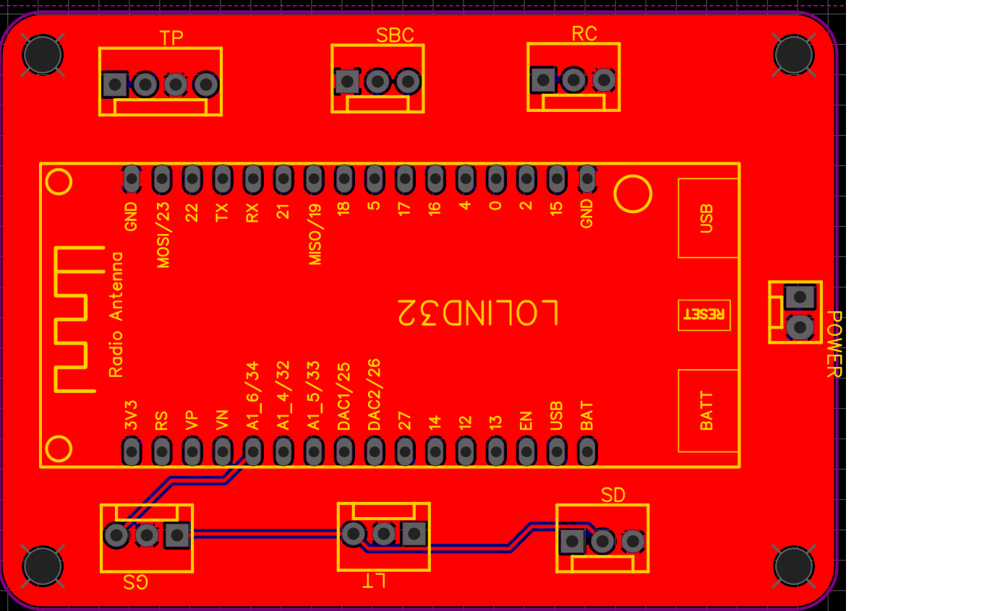
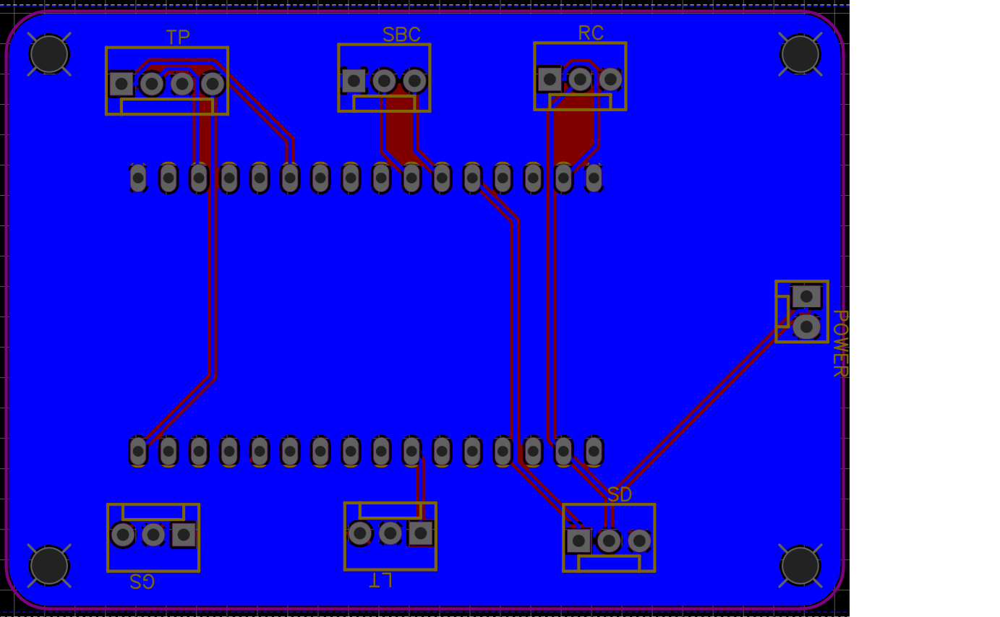
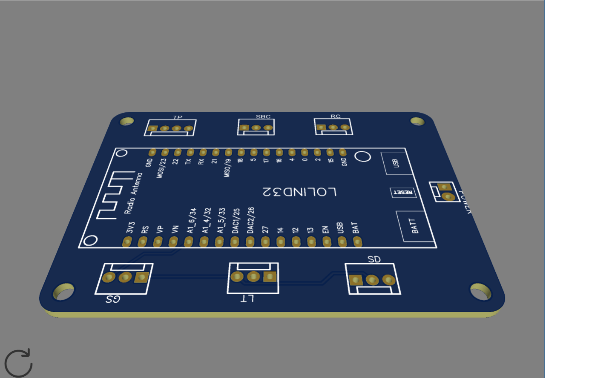
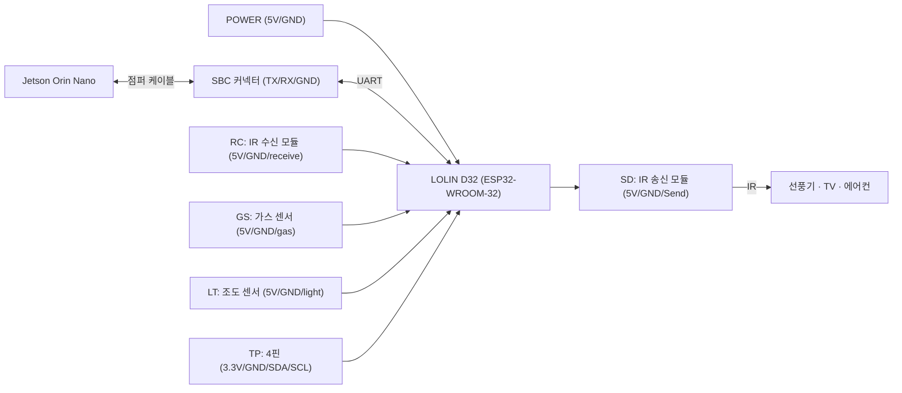

# HESTIA_PCB — ESP32(LOLIN D32) 센서 · IR · UART 캐리어 보드

HESTIA의 MCU 보드(HESTIA_FW `sub_esp.ino`)용 **2층 캐리어 PCB**입니다. LOLIN D32(ESP32-WROOM-32) 개발보드를 꽂고 센서·IR 송수신 모듈·Jetson UART·전원을 커넥터로 정리했습니다.

> **English summary** — Two-layer carrier PCB (EasyEDA) for a LOLIN D32 (ESP32-WROOM-32) board: connectors for gas / light / temperature sensors, IR transmitter and receiver modules, a UART header to the Jetson Orin Nano (SBC), and 5 V power. Gerber and drill files are ready for fabrication.

| 회로도 | PCB 앞면 | PCB 뒷면 | 3D |
|---|---|---|---|
|  |  |  |  |

## 1. 보드 구성

| 커넥터 | 신호 | 용도 |
|---|---|---|
| POWER | 5V, GND | 보드 전원 입력 |
| SBC | TX, RX, GND | Jetson ↔ ESP32 UART |
| GS | 5V, GND, gas | 가스 센서 디지털 출력 |
| LT | 5V, GND, light | 조도 센서 디지털 출력 |
| SD | 5V, GND, Send | IR 송신 모듈 |
| RC | 5V, GND, receive | IR 수신 모듈 |
| TP | 3.3V, GND, SDA, SCL | 4핀 센서 커넥터 |

## 2. 사양 (거버/드릴 파일 기준)

- EDA: EasyEDA 6.5.44 (회로도 `SCH_hestia.json`, 2024-08-14)
- 2층 (Top/Bottom copper, Top silkscreen, 양면 솔더마스크)
- 외곽 77 × 56 mm, 장착홀 4개 (NPTH Ø3.0 mm)
- PTH 드릴 Ø0.889 / Ø1.016 mm, Molex 1×2 / 1×3 / 1×4 커넥터

## 3. 제작 방법

1. `PCB/` 폴더의 거버·드릴 파일 9개를 zip으로 묶어 PCB 제조사(예: JLCPCB)에 업로드 (2층, 1.6 mm 기본 옵션)
2. 참고: `PCB/How-to-order-PCB.txt` (EasyEDA 주문 가이드 링크)
3. 회로도 수정: EasyEDA에서 `SCH_hestia.json` Import

## 4. 펌웨어와의 대응 (`sub_esp.ino`)

| 신호 | 펌웨어 |
|---|---|
| 가스 (GS) | `pinMode(34, INPUT)`, `!digitalRead(34)` |
| 조도 (LT) | `pinMode(27, INPUT)`, `!digitalRead(27)` |
| UART (SBC) | `Serial2` RX16 / TX17, 9600 8N1 |
| 온도 | 펌웨어는 DHT11 단선식(GPIO19), 보드의 TP 커넥터는 SDA/SCL 표기 — 리비전 차이 확인 필요 |
| IR 수신 (RC) | 펌웨어에 수신 코드 없음 |

## 5. My role

- 회로도 title block의 작성자 표기는 `jun11`입니다. PCB 설계 기여 범위는 확인 후 작성 예정입니다.
- **이승석**: 이 보드에서 동작하는 ESP32 펌웨어(HESTIA_FW)와 Jetson 연동, IR 가전 제어, 전체 시스템 통합.
